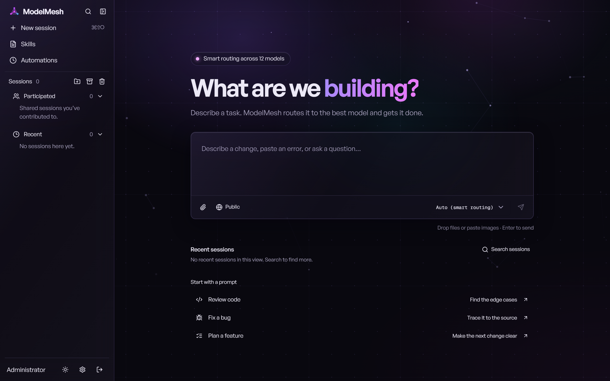

# ModelMesh

ModelMesh is a local AI workspace that routes each message to the model best suited for it. You
chat with an agent that has its own computer (a Docker container per conversation), and the
**Auto** choice picks one of the NCSA Lumen models for every message, using a task-type
classifier (Laya) and a scoreboard built from ModelMesh's own benchmark.

<picture>
  <source media="(prefers-color-scheme: light)" srcset="docs/assets/modelmesh-home-light.png">
  
</picture>

## What it does

- **Auto routing.** For each message on Auto, ModelMesh decides the task type (code, math,
  writing, build and so on) and sends the message to the model that scored best on that task
  type in the benchmark, weighing quality 60%, speed 20% and cost 20%. A pop-up on the message
  shows which model ran it and why; Settings → Routing shows how Auto has been routing and how
  often each model's turns fail.
- **An agent with a computer.** Each conversation gets its own Docker container with Python 3.13
  (uv, pytest), Node.js 22, git, ripgrep, curl and jq. Files persist in `/workspace` between
  turns. Finished files appear in the conversation's Files panel, where you can open or
  download them.
- **Longer work.** Goals keep the agent working toward an outcome; automations run on a
  schedule; swarms and subagents split work across several agents; memory and skills carry
  instructions between conversations.

## How it fits together

```
browser ── 127.0.0.1:8787 ──> app (modelmesh) ──> lumen-gateway (LiteLLM) ──> NCSA Lumen models
                                │      │
                                │      └──> laya (task-type classifier, no published port)
                                └──> Docker socket ──> modelmesh-ws-* (one computer per conversation)
```

| Container | What it runs | Data |
|---|---|---|
| `app` | The API, the web UI, the agent and a local Temporal server for durable turns | `modelmesh-data` volume: SQLite databases, saved files, the master key |
| `lumen-gateway` | LiteLLM, translating the app's Responses API calls into Lumen chat completions | none |
| `laya` | Laya with the classifier trained by `laya/train.py` | `laya-models` volume |
| `modelmesh-ws-*` | A conversation's computer, started by the app | the container's own filesystem |

The app shares the gateway's network and reaches it at `http://127.0.0.1:4000/v1`. Its port is
published on `127.0.0.1` only. Model credentials stay in the gateway and never enter a computer.

## Set up

**You need:** Docker Desktop (Windows or macOS) or Docker Engine with Compose (Linux), with about
8 GB of memory for Docker (Laya alone uses about 2.5 GB), and an NCSA Lumen API key.

1. **Create the three settings files** in the repository root. All three are git-ignored; never
   commit them. `.env.example` lists every variable.

   `.env.lumen`, for the gateway:
   ```dotenv
   LUMEN_API_KEY=your-lumen-key
   # Any long random string. The app uses it to call the gateway.
   LITELLM_MASTER_KEY=a-long-random-string
   ```

   `.env.laya`, shared by the app and Laya:
   ```dotenv
   LAYA_API_KEY=another-long-random-string
   ```

   `modelmesh.env`, for the app:
   ```dotenv
   # Sign in as "admin" with this password.
   WORKSPACE_PASSWORD=a-long-private-password
   LITELLM_API_BASE=http://127.0.0.1:4000/v1
   # The same value as LITELLM_MASTER_KEY above.
   LITELLM_API_KEY=a-long-random-string
   # The default model, and the models to offer (comma-separated). Auto needs at least two.
   AGENT_MODEL=qwen3.8-flash
   MODELMESH_MODELS=beam-1.0,deepseek-v4-flash,deepseek-v4.1-flash,muse-glimmer-30b,qwen3.8-flash
   ```
   The gateway's models are listed in `lumen-gateway/config.yaml`.

2. **Create the volumes and build the images:**
   ```sh
   docker volume create modelmesh-data
   docker volume create laya-models
   docker build -t modelmesh-workspace -f workspace.Dockerfile .
   docker compose build
   ```

3. **Train the classifier once.** The first run downloads Laya's reader model into `laya-models`:
   ```sh
   docker compose run --rm laya python train.py
   ```

4. **Start ModelMesh:**
   ```sh
   docker compose up -d
   ```
   Open <http://127.0.0.1:8787> and sign in as `admin` with `WORKSPACE_PASSWORD`.

Try "draw a cat" with Auto selected. It goes to the build leader, and the drawing appears in the
Files panel as `cat.svg`.

## Auto routing

Auto decides in this order and fails open: if anything goes wrong, the message runs on the
default model.

1. **Rules:** messages with images go to a vision model; very long messages go to a
   long-context model.
2. **Laya:** the classifier names the task type; the scoreboard in
   `native/src/modelmesh/routing_policy.json` names that type's best model.
3. **LLM router:** when Laya is unsure or unreachable, a model reads the message and picks one.
   Set `MODELMESH_ROUTER_MODEL` to choose that model; it defaults to `AGENT_MODEL`.

The scoreboard comes from the benchmark in `benchmarks/` (see its README). After a new run,
`python benchmarks/report.py --run-id <run>` writes the report to `docs/benchmarks/` and a new
`routing_policy.json`; rebuild the app image to use it. Results so far are in
[docs/benchmarks/MODEL-BENCHMARKS.md](docs/benchmarks/MODEL-BENCHMARKS.md).

## Operate

- **Logs:** `docker compose logs -f app`.
- **Stop and start:** `docker compose stop` and `docker compose start`. Data stays in the
  `modelmesh-data` volume, which `docker compose down` does not remove.
- **Back up** the `modelmesh-data` volume. It holds `.master-key`; without that key the saved
  conversations and files cannot be read.
- **A Lumen key ran out of credits:** put the new key in `.env.lumen`, then recreate the gateway
  and the app together (the app uses the gateway's network):
  `docker compose up -d --force-recreate lumen-gateway app`.
- **Computers:** ModelMesh never removes a conversation's container, even after the conversation
  is deleted. Remove one with `docker rm -f <name>` once you no longer need its files; `docker ps
  -a --filter name=modelmesh-ws-` lists them.
- **Security:** ModelMesh is for local use. Keep these in mind:
  - The app mounts the Docker socket to start computers. That gives it root-equivalent access to
    the Docker host and, on Docker Desktop, to your Windows files. Do not publish port 8787
    beyond `127.0.0.1`.
  - Each computer is limited to 2 GB of memory, 2 CPUs and 512 processes, so one runaway job
    cannot take down Laya, the gateway or the app. One turn can start at most 6 subagents.
  - Computers can reach the internet and, through `host.docker.internal`, services on your PC.
    Treat web pages and files the agent reads as untrusted: anything the agent can read,
    instructions hidden in that content could try to send out. After working with untrusted
    content, check Settings → Memory for notes you did not expect.
  - Saved conversations and files in `modelmesh.db` and `objects/` are encrypted with
    `.master-key`. The agent's run history and memory in `agent-state.db` are not, and the key
    sits in the same volume, so protect the volume and its backups.
  - New conversations are shared by default, which matters only once you add a second account:
    every account sees shared conversations. Make conversations private before adding one.
  - Optional hardening: add `MODELMESH_PUBLIC_URL=http://127.0.0.1:8787` to `modelmesh.env`, so
    that only pages served from that address can sign in or send changes, and then always open
    ModelMesh at that address rather than `localhost`.

## Develop

```sh
# Python tests, in the app image with this checkout mounted (no local Python needed)
docker run --rm --memory=2g -v "$PWD:/work" -w /work -e PYTHONPATH=/work/native/src:/work \
  --entrypoint sh modelmesh -c "uv pip install --python /app/.venv/bin/python -q pytest pytest-asyncio \
  && /app/.venv/bin/python -m pytest native/tests tests -q"

# Web UI
npm ci
npm run typecheck && npm test && npm run build

# Lint
uv run ruff check native/src native/tests tests benchmarks laya
```

On Windows Git Bash, prefix the `docker run` line with `MSYS_NO_PATHCONV=1` and use `$(pwd -W)`.
CI (`.github/workflows/ci.yml`) runs the same checks on every push: lint and types, the Python
tests, and the web UI's type check, unit tests, build and browser tests.
After changing an API route or payload, regenerate the typed client with `npm run api:generate`
(see `.agents/skills/e2e-typesafety/SKILL.md`). UI work follows `.agents/skills/modelmesh-ui/SKILL.md`.

## Repository layout

| Path | Contents |
|---|---|
| `native/src/modelmesh/` | The app: API, workflows, agent, Auto router, Docker computers |
| `native/web/`, `frontend/` | The React UI and its shared shadcn components |
| `native/instructions.md`, `native/skills/` | The agent's instructions and bundled skills |
| `laya/` | The classifier service, its training data and training script |
| `lumen-gateway/config.yaml` | The LiteLLM gateway's Lumen models |
| `benchmarks/` | Benchmark items, runner, graders and the report that builds the scoreboard |
| `docs/` | Design notes, benchmark reports and plans |
| `tests/`, `native/tests/` | Tests |

## License

MIT; see [LICENSE](LICENSE). ModelMesh started from an MIT-licensed project, whose copyright
notice the license requires to stay.
